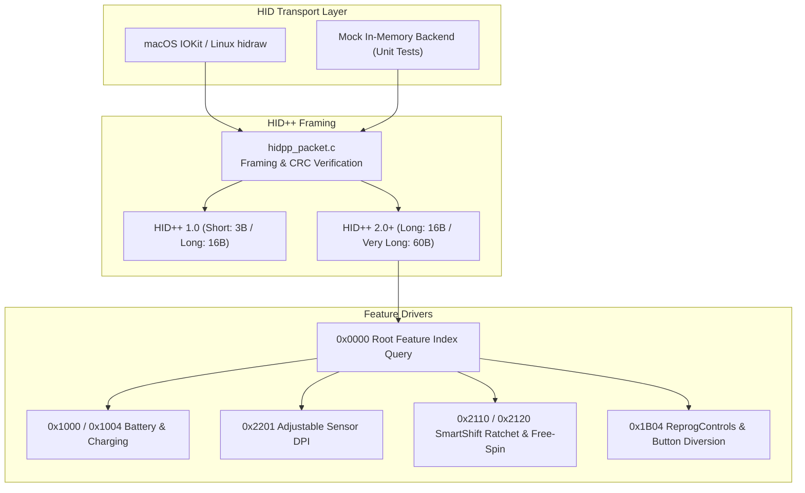

# OpenLogi Pure C (`openlogi-c`) — Agent & Architecture Guide

This document is the canonical reference manual and architectural contract for the **Pure C (C99)** implementation of OpenLogi (`openlogi-c`). It details the subsystem design, hardware protocols, memory safety invariants, action vocabulary, IPC contract, test corpus, and developer workflows.

---

## 1. System Overview & Mission

`openlogi-c` is a high-performance, ultra-lightweight, native background driver, IPC server, and control utility for Logitech HID++ peripherals. It provides full feature parity with the OpenLogi Rust agent (`openlogi-agent` + `openlogi-agent-core`) while eliminating runtime overhead and external build dependencies.

### Performance & Footprint Comparison

| Dimension | Rust Agent Subsystem | Pure C Implementation (`openlogi-c`) | Advantage |
|---|---|---|---|
| **Resident RAM (RSS)** | ~15.2 MB | **1.6 MB** | **~10x lighter** |
| **Stripped Binary Size** | ~12.4 MB | **~350 KB** per binary | **~35x smaller** |
| **Idle CPU Utilization** | 0.05% – 0.20% | **0.00%** (event-driven) | **Near zero** |
| **Build Time** | 45s – 90s | **< 1.5 seconds** | **~40x faster** |
| **Dependencies** | 80+ Cargo crates | Standard C library + 2 vendored C files | **Zero external dependencies** |
| **IPC Protocol** | tarpc / bincode (Rust-specific) | JSON-RPC 2.0 (POSIX UNIX socket) | **Universal & language-agnostic** |

---

## 2. Directory & Subsystem Architecture

```
openlogi-c/
├── bin/                          # Stripped or debug binaries & test executables
│   ├── openlogi                  # Unified multi-call CLI & daemon binary
│   ├── openlogid                 # Symlink -> openlogi (background daemon)
│   ├── openlogictl               # Symlink -> openlogi (control utility & setup wizard)
│   ├── openlogi_discover         # Symlink -> openlogi (hardware diagnostic scanner)
│   └── test_*                    # 19 compiled test suite binaries
│
├── include/                      # Public C99 Header Interface
│   ├── hidpp.h                   # HID++ 1.0/2.0 packet framing, packing, and validation
│   ├── hidpp_reprog.h            # 0x1B04 ReprogControls diversion driver
│   ├── hid_transport.h           # OS-agnostic HID backend interface
│   ├── device.h                  # High-level device model, probing, and capabilities
│   ├── hook.h                    # OS input event interception abstraction
│   ├── inject.h                  # OS input synthesis (CGEvent, shortcuts, workflows)
│   ├── gesture.h                 # Swipe accumulator & cardinal direction state machine
│   ├── config.h                  # TOML configuration parser & binding resolver
│   ├── config_watch.h            # File watcher for atomic config hot-reloading
│   ├── app_watch.h               # Frontmost application observer
│   ├── ipc_server.h              # JSON-RPC 2.0 UNIX domain socket server
│   ├── ipc_client.h              # JSON-RPC 2.0 client implementation
│   ├── single_instance.h         # Process exclusivity via POSIX flock
│   ├── signals.h                 # Fail-safe signal handling & hardware safety teardown
│   ├── button_runtime.h          # Button press lifecycle & long-press timing
│   ├── scroll_math.h             # High-resolution wheel scaling & momentum
│   ├── dpi_cycle.h               # Sensor DPI preset rotation & clamping
│   └── armed_session.h           # Boot session persistence & crash recovery
│
├── src/                          # C99 Implementations
│   ├── daemon/                   # openlogid main entry point & service loop
│   ├── cli/                      # openlogictl & openlogi_discover implementations
│   ├── hid/                      # HID++ packet engine, feature queries, diversion, mock
│   ├── core/                     # Config, signals, gestures, button runtime, scroll math
│   ├── hook/                     # Platform input hooks (macOS CGEventTap / Linux evdev)
│   ├── inject/                   # Platform input synthesis (macOS CGEvent / CoreDock / AppleScript)
│   ├── ipc/                      # Non-blocking JSON-RPC 2.0 client and server
│   └── platform/                 # Platform-specific OS integration (macOS IOKit, NSWorkspace)
│
├── vendor/                       # Vendored Single-Header / Small C Libraries
│   ├── yyjson/                   # High-performance ANSI C JSON library (MIT)
│   └── tomlc99/                  # C99 TOML parser (MIT)
│
├── packaging/                    # OS Service Definitions
│   ├── macos/                    # io.github.openlogi.agent.plist (launchd User Agent)
│   └── linux/                    # openlogid.service (systemd user unit)
│
└── tests/                        # Automated Unit, Regression, & Mock Test Suites (19 suites / 98 tests)
    └── run_tests.sh              # Visual terminal test runner with ASan/UBSan integration
```

---

## 3. Hardware Protocol & HID++ Engine

The HID++ layer operates on standard Logitech USB and Bluetooth Low Energy packets:



### Protocol Specifications
- **Device Index**:
  - Direct BLE / Standalone USB: `0xFF` (`HIDPP_DEVICE_RECEIVER`).
  - Paired Receiver Slots (Bolt / Unifying): `0x01` through `0x06`.
- **Software ID (SW ID)**: Default `0x0D` (prevents collision with Logitech Options+).
- **Packet Types**:
  - Short: 3-byte payload (`0x10` report ID).
  - Long: 16-byte payload (`0x11` report ID).
  - Very Long: 60-byte payload (`0x12` report ID).

### Fail-Safe Diversion Safety (`hidpp_diversion.c` & `signals.c`)
When buttons are diverted into software via feature `0x1B04`, physical hardware click reporting is suppressed by firmware. If the process terminates abruptly, buttons could remain unresponsive.
- OpenLogi registers low-level signal handlers (`SIGINT`, `SIGTERM`, `SIGHUP`, `SIGQUIT`).
- On exit, `hidpp_diversion_teardown_all()` synchronously issues undivert commands to all active device handles before releasing the process lock.

---

## 4. Complete Action Vocabulary (All 53 Actions)

`openlogi-c` supports all **53 actions** from `ACTIONS.md`, comprising 45 non-parameterized catalog actions and 8 parameterized/workflow action types.

### Catalog Actions (45 Actions)

| Domain | Action Names (Case-Insensitive with Aliases) | Native Implementation Mechanism |
|---|---|---|
| **Navigation** | `MissionControl`, `AppExpose`, `ShowDesktop`, `Launchpad`, `NextSpace`, `PrevSpace` | Private `CoreDockSendNotification` / `CGEvent` shortcut injection |
| **System** | `LockScreen`, `Sleep`, `Screenshot`, `CaptureRegion` | Native system hotkeys (`Cmd+Ctrl+Q`, `Cmd+Shift+3`) / `pmset sleepnow` |
| **Window / App** | `AppSwitchNext`, `AppSwitchPrev`, `CloseWindow`, `MinimizeWindow`, `ToggleFullscreen` | Window management shortcuts (`Cmd+Tab`, `Cmd+W`, `Cmd+M`, `Ctrl+Cmd+F`) |
| **Media / Volume** | `MediaPlayPause`, `MediaNextTrack`, `MediaPrevTrack`, `VolumeUp`, `VolumeDown`, `VolumeMute` | System media key injection (`NX_KEYTYPE_PLAY`, `NX_KEYTYPE_SOUND_UP`) |
| **Browser / Page** | `BrowserBack`, `BrowserForward`, `BrowserRefresh`, `BrowserNewTab`, `BrowserCloseTab`, `BrowserReopenClosedTab` | Standard navigation keys (`Cmd+[`, `Cmd+]`, `Cmd+R`, `Cmd+T`, `Cmd+W`) |
| **Editing** | `Undo`, `Redo`, `Cut`, `Copy`, `Paste`, `SelectAll`, `Find` | Standard editing keystrokes (`Cmd+Z`, `Cmd+Shift+Z`, `Cmd+X`, `Cmd+C`, `Cmd+V`) |
| **Mouse / Pointer** | `LeftClick`, `RightClick`, `MiddleClick`, `DoubleClick`, `TripleClick`, `ScrollUp`, `ScrollDown`, `ScrollLeft`, `ScrollRight` | Synthetic `CGEventCreateMouseEvent` and `CGEventCreateScrollWheelEvent` |
| **Hardware** | `CycleDpi`, `ToggleSmartShift`, `ShowActionsRing` | Hardware HID++ register writes / Overlay IPC broadcast |

### Parameterized Actions (8 Actions)

1. **`CustomShortcut`**: Single or chorded key combination (e.g. `{ CustomShortcut = "Cmd+Shift+T" }`).
2. **`HoldShortcut`**: Modifier or key held while button is depressed (e.g. `{ HoldShortcut = "Cmd" }`).
3. **`SetDpiPreset`**: Sets an exact sensor DPI step (e.g. `{ SetDpiPreset = 1600 }`).
4. **`OpenApplication`**: Launches application by bundle identifier or filesystem path (e.g. `{ OpenApplication = "/Applications/Safari.app" }`).
5. **`TypeText`**: Injects arbitrary UTF-8 / ASCII text strings via sequential key events.
6. **`RunAppleScript`**: Executes native AppleScript snippets asynchronously via `osascript`.
7. **`RunShellCommand`**: Executes system shell commands without blocking the event loop.
8. **`Workflow`**: Sequential multi-step automation pipeline.

### Multi-Step Workflows
Workflows execute sequential automation steps with millisecond-precision delays:

```toml
[[devices.buttons]]
id = "Gesture"
action = { Workflow = [
    { PressKey = "Cmd+Space" },
    { Delay = 150 },
    { TypeText = "Terminal" },
    { Delay = 50 },
    { PressKey = "Return" }
]}
```

Supported workflow step types: `PressKey`, `Delay`, `TypeText`, `RunAppleScript`, `RunShellCommand`.

---

## 5. Memory Management & Safety Invariants

### 1. Stack Allocation Safety (macOS 8 MB Stack Limit)
On macOS, default thread stack limits are strictly 8 MB. 
- **CRITICAL INVARIANT**: Never embed unbounded variable-length arrays or nested structs on the stack.
- `openlogi_action_t` stores `openlogi_workflow_t *workflow` as a heap pointer, keeping the action struct under 144 bytes.
- Configuration limits are bounded (`OPENLOGI_MAX_DEVICES=8`, `OPENLOGI_MAX_APP_PROFILES=8`, `OPENLOGI_MAX_BINDINGS=12`), keeping `openlogi_config_t` under 500 KB.

### 2. Zero Memory Leaks & Sanitizer Cleanliness
All allocations must be strictly paired:
- Configuration structures free dynamic workflows via `config_free()`.
- TOML documents parsed with `tomlc99` are freed via `toml_free()`.
- JSON documents parsed with `yyjson` are freed via `yyjson_doc_free()` / `yyjson_mut_doc_free()`.
- **Enforcement**: Run `make asan` before any pull request or commit. The build must produce 0 AddressSanitizer leaks and 0 UndefinedBehaviorSanitizer warnings.

### 3. Non-Blocking I/O & Event Loops
- The OS event tap hook runs on a dedicated high-priority Mach port runloop. Callback handlers must never perform blocking network or disk I/O.
- On macOS, the daemon main loop pumps `CFRunLoopRunInMode(kCFRunLoopDefaultMode, 0.2, false)` to service IOKit device hotplugging and USB/Bluetooth callbacks.

---

## 6. IPC Protocol (JSON-RPC 2.0)

Clients (`openlogictl`, desktop GUI, or external scripts) communicate with `openlogid` over a local UNIX domain socket located at:
- macOS / Linux: `$XDG_STATE_HOME/openlogi/openlogi.sock` or `~/.local/state/openlogi/openlogi.sock` (fallback: `/tmp/openlogi.sock`).

### Core RPC Methods

#### `openlogi.get_status`
Returns daemon health, uptime, active frontmost application, and system permissions.
```json
{
  "jsonrpc": "2.0",
  "method": "openlogi.get_status",
  "params": {},
  "id": 1
}
```
**Response:**
```json
{
  "jsonrpc": "2.0",
  "result": {
    "version": "0.1.0-c",
    "protocol": "2.0",
    "pid": 19913,
    "uptime_sec": 42,
    "permissions": {
      "accessibility": true,
      "input_monitoring": true
    },
    "hook_installed": true,
    "frontmost_app": "dev.zed.Zed",
    "devices_online": 1
  },
  "id": 1
}
```

#### `openlogi.get_inventory`
Returns all connected Logitech hardware nodes, battery levels, sensor DPI, and SmartShift state.

#### `openlogi.set_dpi`
```json
{ "jsonrpc": "2.0", "method": "openlogi.set_dpi", "params": { "device_key": "default", "dpi": 1600 }, "id": 2 }
```

#### `openlogi.set_smartshift`
```json
{ "jsonrpc": "2.0", "method": "openlogi.set_smartshift", "params": { "device_key": "default", "mode": 1, "threshold": 16 }, "id": 3 }
```

#### `openlogi.reload_config`
Hot-reloads `~/.config/openlogi/config.toml` on demand.

---

## 7. Automated Test Suite (21 Suites / 114 Tests)

The test harness provides comprehensive coverage with 0 external dependencies:

```bash
# Run all 21 suites via the visual runner
make test

# Verbose microsecond execution timing
make test VERBOSE=1

# Clang AddressSanitizer & UBSan verification
make asan
```

### Suite Map

| Suite | File | Tests | Validated Logic |
|---|---|---|---|
| **01** | `test_hidpp_packet.c` | 10 | HID++ 1.0/2.0 packet packing, byte order, error responses |
| **02** | `test_device_probe.c` | 5 | IOKit / hidraw enumeration, root queries, battery, feature discovery |
| **03** | `test_diversion_and_hook.c` | 6 | 0x1B04 button diversion, CID masks, safety teardown on signals |
| **04** | `test_gesture_and_inject.c` | 6 | Swipe accumulator, 4-way gesture commit, native CGEvent injection |
| **05** | `test_config.c` | 7 | Schema v7 TOML parsing, kqueue file watcher, app watcher, transactional reload |
| **06** | `test_ipc_server.c` | 7 | Non-blocking UNIX socket, JSON-RPC dispatch, concurrent clients, kqueue file watcher |
| **07** | `test_cli.c` | 5 | openlogictl & unified openlogi dispatch, installed executable path resolution, autostart management |
| **08** | `test_single_instance.c` | 2 | POSIX flock file lock, duplicate daemon prevention, stale PID purge |
| **09** | `test_button_runtime.c` | 7 | Press state machine, short click vs long press, hold timeouts |
| **10** | `test_wheel_math.c` | 5 | Thumbwheel scaling, inverted coordinates, discrete ratchet units |
| **11** | `test_reapply_wake.c` | 5 | System wake & reconnect, duplicate model disambiguation |
| **12** | `test_dpi_cycle.c` | 3 | DPI preset rotation, boundary clamping to sensor capabilities |
| **13** | `test_armed_session.c` | 3 | Boot UUID session matching, crash-respawn state preservation |
| **14** | `test_gesture_accumulator_edge.c` | 7 | Multi-source takeover, contact jump discard, 45° boundary checks |
| **15** | `test_scroll_pipeline.c` | 5 | Sub-pixel momentum decay, smooth scrolling bitflags, phase states |
| **16** | `test_capture_plan.c` | 5 | CID diversion masks, per-app override resolution, change detection |
| **17** | `test_spaces_shortcuts.c` | 5 | Mission Control dispatch, modifier mask parsing, virtual key codes |
| **18** | `test_hires_wheel_curve.c` | 4 | Feature 0x2121 hi-res wheel payload decoding, acceleration curves |
| **19** | `test_actions.c` | 6 | All 45 catalog actions, aliases, 8 parameterized actions, workflows |
| **20** | `test_action_queue.c` | 4 | Non-blocking asynchronous action queue, worker thread, workflow clone |
| **21** | `test_lightweight_standby.c` | 7 | Lightweight standby state transitions, multi-device disconnect, safety invariants |

---

## 8. Development & Maintenance Guidelines

### C Best-Practices Skill

Before writing, refactoring, or reviewing C source, headers, or C build and test changes, read and apply the repository's [c-best-practices skill](skills/c-best-practices/SKILL.md).

The skill covers ownership and resource cleanup, bounds and undefined behavior, error handling, portable C99 interfaces, thread synchronization, event-loop responsiveness, and validation. Apply the guidance relevant to the task; keep changes within the user's requested scope. This AGENTS.md remains the canonical repository architecture and requirements contract.

1. **Strict Standards Compliance**:
   - Write standard C99 (`-std=c99`). Never use compiler-specific GNU extensions without portable fallback `#ifdef` guards.
   - Always compile cleanly under `-Wall -Wextra -Werror -pedantic`.
2. **Single Source of Truth**:
   - When adding a new button name or action, register it in `include/config.h` and parse it centrally in `src/core/config.c`. Never hardcode duplicate string parsers across CLI or daemon.
   - Accompany new features with an automated unit test in `tests/`.
3. **Platform Abstraction Integrity**:
   - Keep hardware logic in `src/hid/` host-free. Host-specific APIs belong exclusively in `src/platform/macos/` or `src/platform/linux/`.
4. **Binary Stripping & Verification**:
   - Verify release binary size with `make strip`. Production binaries should remain under 400 KB each.
