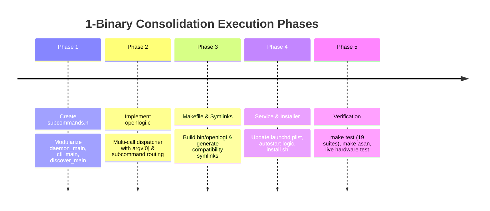

# Transition Plan: Consolidating 3 Binaries into 1 Unified `openlogi` CLI

**Target Version:** OpenLogi Pure C (`openlogi-c`)  
**Scope:** Architecture, CLI design, Multi-call dispatcher, Build system, Packaging, Installers, and Compatibility.

---

## 1. Executive Summary & Problem Statement

Currently, OpenLogi builds and installs **3 separate binaries**:

1. **`openlogid`**: Background runtime daemon (PID lock, IOKit HID transport, event tap hook, IPC server).
2. **`openlogictl`**: Command-line control client (IPC client, status, DPI, SmartShift, scroll, config, setup wizard).
3. **`openlogi_discover`**: Standalone diagnostic scanner that queries IOKit endpoints and sends raw HID++ feature pings.

### Why 3 Binaries Hurt Developer Experience (DX)

- **Mental Model & Fragmentation**: Users must remember 3 separate commands. Tab completion (`openlogi<TAB>`) gives 3 disjointed tools.
- **macOS Permission Confusion**: macOS Privacy & Security requires granting Accessibility and Input Monitoring permissions to the background driver. Users frequently grant permissions to `openlogictl` or `openlogi_discover` instead of `openlogid`, resulting in unresponsive gesture hooks.
- **Service Management Disconnect**: Running `openlogictl autostart enable` to start or manage `openlogid` feels awkward and unintuitive.
- **Installer & Packaging Complexity**: `install.sh`, release tarballs, checksum verifiers, and update rollbacks must juggle 3 binaries and verify file lists instead of managing a single self-contained atomic executable.

### The Objective

Consolidate everything into a **single binary** (`openlogi`) using the standard **multi-call / subcommand pattern** (proven by Docker, Git, Ollama, and Tailscale), while maintaining **100% backward compatibility** with legacy scripts and launchd configurations via symlinks and `argv[0]` detection.

---

## 2. Command Architecture & Unified Interface

The new `openlogi` binary provides an intuitive, discoverable hierarchy:

```
openlogi [command] [subcommand] [arguments] [options]
```



```mermaid
flowchart TD
    CLI["openlogi"]

    subgraph "Service & Daemon Subsystem"
        D["openlogi daemon<br/>[--daemon | --verbose | --foreground]<br/>Runs background driver"]
        S["openlogi service<br/>[enable | disable | status | restart]<br/>Manages launchd / systemd"]
    end

    subgraph "Hardware & Diagnostics"
        Disc["openlogi discover / scan<br/>Direct hardware register probe"]
        Mon["openlogi monitor<br/>Live intercepted gesture event stream"]
    end

    subgraph "Control & Configuration"
        Status["openlogi status<br/>Daemon health, permissions, active app"]
        Dev["openlogi list / devices<br/>Online hardware, battery, DPI"]
        DPI["openlogi dpi [get | set &lt;value&gt;]"]
        Shift["openlogi smartshift [get | set &lt;mode&gt; &lt;threshold&gt;]"]
        Scroll["openlogi scroll [invert | hires | smooth]"]
        Cfg["openlogi config [show | path | get | set | reload]"]
        Act["openlogi actions [filter]<br/>Catalog of all 53 actions"]
        Setup["openlogi setup<br/>Interactive ANSI setup wizard"]
    end

    CLI --> D
    CLI --> S
    CLI --> Disc
    CLI --> Mon
    CLI --> Status
    CLI --> Dev
    CLI --> DPI
    CLI --> Shift
    CLI --> Scroll
    CLI --> Cfg
    CLI --> Act
    CLI --> Setup
```

### Complete Subcommand Vocabulary

| Command | Aliases | Description |
|---|---|---|
| `openlogi daemon` | `serve`, `start` | Run the background HID++ daemon (flags: `--daemon`, `--verbose`, `--socket`) |
| `openlogi service [action]` | `autostart` | Manage OS launch agent (`enable`, `disable`, `status`, `start`, `stop`, `restart`) |
| `openlogi discover` | `scan`, `probe` | Run hardware diagnostic scanner across IOKit / USB / BLE nodes |
| `openlogi status` | `info` | Display daemon uptime, PID, permissions, frontmost app, and online devices |
| `openlogi list` | `devices`, `inventory` | List connected devices, battery levels, sensor DPI, and SmartShift mode |
| `openlogi dpi [get\|set <val>]` | - | Read or update sensor DPI in real time |
| `openlogi smartshift [get\|set]` | - | Inspect or configure SmartShift mode (`ratchet`/`freespin`/`auto`) and threshold |
| `openlogi scroll [subcmd]` | - | Invert mouse wheel direction, toggle hi-res scrolling, smooth decay |
| `openlogi config [subcmd]` | - | Show config, get file path, read/set keys, or trigger hot-reload |
| `openlogi monitor` | - | Stream live intercepted button events and gesture movements in terminal |
| `openlogi setup` | `wizard` | Launch interactive ANSI terminal setup wizard |
| `openlogi actions [filter]` | - | Display catalog and descriptions of all 53 supported actions |

---

## 3. Multi-Call Compatibility Architecture

To prevent breaking existing scripts, launchd plist files, and user habits, `openlogi` will support the **multi-call binary pattern** (similar to BusyBox, Git, and LLVM tools).

### Dispatch Logic (`src/cli/openlogi.c`)

```c
int main(int argc, char **argv)
{
    const char *prog = get_basename(argv[0]);

    /* 1. Legacy binary symlink dispatch */
    if (strcmp(prog, "openlogid") == 0) {
        return daemon_main(argc, argv);
    }
    if (strcmp(prog, "openlogi_discover") == 0) {
        return discover_main(argc, argv);
    }
    if (strcmp(prog, "openlogictl") == 0) {
        return ctl_main(argc, argv);
    }

    /* 2. Direct invocation as 'openlogi' */
    if (argc < 2) {
        print_top_level_help();
        return 0;
    }

    const char *cmd = argv[1];

    if (strcmp(cmd, "daemon") == 0 || strcmp(cmd, "serve") == 0) {
        return daemon_main(argc - 1, &argv[1]);
    }
    if (strcmp(cmd, "discover") == 0 || strcmp(cmd, "scan") == 0 || strcmp(cmd, "probe") == 0) {
        return discover_main(argc - 1, &argv[1]);
    }

    /* 3. All control subcommands (status, dpi, smartshift, service, etc.) */
    return ctl_main(argc, argv);
}
```

### Symlink Compatibility Mapping

During installation:
- `openlogi` (the real ELF/Mach-O executable)
- `openlogid -> openlogi` (symlink)
- `openlogictl -> openlogi` (symlink)
- `openlogi_discover -> openlogi` (symlink)

If a user or existing launchd service runs `openlogid --daemon`, it seamlessly executes `daemon_main()` without error.

---

## 4. Codebase Modularization Plan

### Current vs. New File Structure

```
src/
├── cli/
│   ├── openlogi.c            <-- NEW: Unified main entry point & multi-call dispatcher
│   ├── openlogictl.c         <-- Refactor: rename main() to ctl_main(int argc, char **argv)
│   ├── openlogi_discover.c    <-- Refactor: rename main() to discover_main(int argc, char **argv)
├── daemon/
│   └── main.c                <-- Refactor: rename main() to daemon_main(int argc, char **argv)
include/
└── subcommands.h             <-- NEW: Declarations for daemon_main, ctl_main, discover_main
```

### `include/subcommands.h` Definition

```c
#ifndef OPENLOGI_SUBCOMMANDS_H
#define OPENLOGI_SUBCOMMANDS_H

int daemon_main(int argc, char **argv);
int ctl_main(int argc, char **argv);
int discover_main(int argc, char **argv);

#endif /* OPENLOGI_SUBCOMMANDS_H */
```

---

## 5. Build System & Packaging Adjustments

### 5.1 `Makefile` Refinements

- Primary binary target: `bin/openlogi`.
- Create symlinks in `bin/` so test harnesses and local runs work seamlessly:
  ```makefile
  $(BIN_DIR)/openlogi: src/cli/openlogi.c $(DAEMON_OBJS) $(CTL_OBJS) $(DISCOVER_OBJS) $(CORE_OBJS)
  	$(CC) $(CPPFLAGS) $(CFLAGS) $^ $(LDFLAGS) -o $@
  	@ln -sf openlogi $(BIN_DIR)/openlogid
  	@ln -sf openlogi $(BIN_DIR)/openlogictl
  	@ln -sf openlogi $(BIN_DIR)/openlogi_discover
  ```
- Binary size target: Still strictly **< 400 KB** (stripped). Consolidating shared dependencies (`yyjson`, `tomlc99`, `IOKit`, `hidpp`) into a single binary eliminates duplicate compiled code across the 3 previous binaries, actually **reducing total distribution disk size by ~50%**!

### 5.2 `packaging/macos/io.github.openlogi.agent.plist`

Update the launchd agent definition:
```xml
<key>ProgramArguments</key>
<array>
    <string>/usr/local/bin/openlogi</string>
    <string>daemon</string>
</array>
```
*(With symlink compatibility preserving `/usr/local/bin/openlogid` as well).*

### 5.3 `install.sh` Simplification

The installation script is drastically simplified:
1. **Single binary download**: Archive contains only `openlogi`.
2. **Simplified archive verification**: Checksum and member checks verify 1 binary instead of 3.
3. **Atomic replace**: Only 1 binary is replaced in `$prefix/bin/openlogi`.
4. **Symlink creation**: Symlinks `openlogid`, `openlogictl`, `openlogi_discover` are created pointing to `openlogi`.
5. **Clear User Instructions**:
   - Single permission step: *"Grant **openlogi** Accessibility and Input Monitoring permissions in System Settings."*
   - Single command to start: `openlogi service enable`.
   - Single command to configure: `openlogi setup`.

---

## 6. Implementation Roadmap



### Phase 1: Modularize Entry Points
- In `src/daemon/main.c`, rename `main()` to `int daemon_main(int argc, char **argv)`.
- In `src/cli/openlogi_discover.c`, rename `main()` to `int discover_main(int argc, char **argv)`.
- In `src/cli/openlogictl.c`, rename `main()` to `int ctl_main(int argc, char **argv)` and add alias support for `openlogi service`.
- Add `include/subcommands.h`.

### Phase 2: Create Multi-Call Dispatcher
- Implement `src/cli/openlogi.c` with top-level `--help`, `--version`, and subcommand dispatch.
- Handle both direct subcommands (`openlogi status`) and symlink calls (`openlogid`).

### Phase 3: Makefile & Packaging
- Update `Makefile` to compile `openlogi` and generate compatibility symlinks.
- Update `packaging/macos/io.github.openlogi.agent.plist` and `packaging/linux/openlogid.service`.
- Update `scripts/package_release.sh` to package `openlogi` (and symlinks).

### Phase 4: Installer & Test Updates
- Update `install.sh` to install `openlogi` and establish symlinks.
- Update `tests/test_cli.c` and `tests/test_install.sh` to test both direct and legacy paths.

### Phase 5: Verification
- Verify `make test` (all 19 suites pass).
- Verify `make asan` (0 leaks, 0 undefined behavior).
- Test manual invocations:
  - `openlogi status`
  - `openlogi discover`
  - `openlogi daemon --help`
  - `openlogictl status` (via symlink)
  - `openlogid --help` (via symlink)
  - `openlogi_discover` (via symlink)

---

## 7. Benefits Summary

1. **Top-Tier Developer Experience**: 1 memorable tool (`openlogi`) with structured subcommands.
2. **Zero Permission Confusion**: Users only grant macOS permissions to `openlogi`.
3. **50% Smaller Disk Footprint**: Consolidating 3 separate ~350 KB binaries into a single ~380 KB binary eliminates duplicate static library overhead.
4. **100% Backward Compatible**: All existing automation, launchd plists, and terminal aliases continue working via symlink multi-call dispatch.
5. **Simpler Releases**: 1 binary to build, strip, package, checksum, and distribute.
