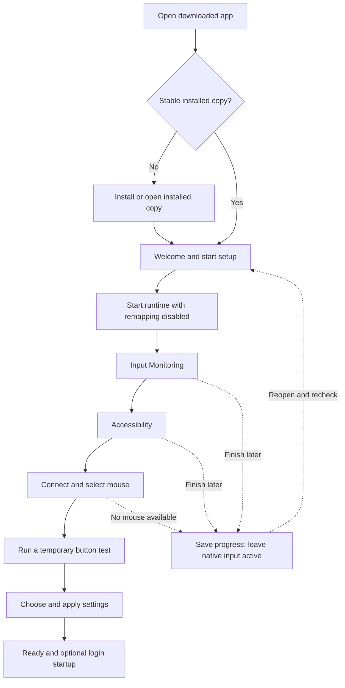

# OpenLogi: reliable installation and user onboarding

Reviewed **2026-10-15** against commit **`601764577c1d0ab659aad8dba1b441364f9c3a30`** (`0.1.7-c`).

**Recommendation:** replace the current alerts with one persistent setup window that guides installation, requests one permission at a time, resumes after reopening, and verifies the selected mouse before enabling remapping. Make the background runtime safe while setup is incomplete. A better DMG presentation alone will not fix the current startup and permission problems.

This is a proposed implementation plan, not a completed onboarding implementation. Findings below come from source inspection; permission attribution, Gatekeeper behavior, and fresh-install failures have not been reproduced on a clean Mac during this review. The broader engineering review is in [latest-imporvements.md](latest-imporvements.md), particularly R01–R05, R09, R14–R16, and R19.

## 1. Why the current experience feels unstable

| Current behavior and evidence | User impact | Required change |
| --- | --- | --- |
| [App dispatch](src/cli/openlogi.c#L306) routes any `openlogi` executable inside an app bundle to the interactive launch handler before parsing explicit commands. | A service launch such as `OpenLogi.app/Contents/MacOS/openlogi daemon` can enter setup/UI behavior. Command-line help can also enter that path. | Parse explicit service and CLI modes first. Only an actual interactive launch opens the setup window. |
| [App permission setup](src/cli/openlogi.c#L71) opens Accessibility and Input Monitoring settings in quick succession and launches a separate AppleScript alert. | The second pane replaces the first; the user loses the sequence and has no persistent progress indicator. | One permission screen, one deliberate request, and one Settings destination at a time. |
| Permission requests also exist in [daemon startup](src/daemon/main.c#L1030), [CLI helpers](src/cli/openlogictl.c#L1478), and [HID initialization](src/platform/macos/hid_iokit.c#L350). | Multiple entry points can request access, including background startup and recovery. The user may grant access to a process other than the one doing the work. | Centralize requests behind the interactive setup controller and execute them in the intended permission-owning process. |
| [Permission waiting](src/cli/openlogictl.c#L1519) can fall back to checking the CLI process if the daemon cannot be queried. [Status](src/ipc/ipc_server.c#L128) combines IOHID and CG preflight results with an OR. | A green check can hide an unavailable daemon or a backend that still lacks access. | Report each backend check from its actual owner; unavailable means unknown, not success. |
| [App launch](src/cli/openlogi.c#L104) writes a LaunchAgent before setup completes, uses the current app executable path, and treats an existing plist as sufficient. It does not bootstrap the newly written agent there. | Startup preference, service registration, and running process can disagree. Launching from a DMG could persist a temporary path; that consequence needs a real installation test. | Validate the installation first; make login startup an explicit choice and verify registration separately. |
| [App reopen handling](src/cli/openlogi.c#L160) uses an existing PID to show “OpenLogi is Running,” with a connected-device default if inventory cannot be read. | Reopening does not reliably return the user to the missing permission or failed startup step. | Reopen the setup/status window and use an authenticated, current runtime response. |
| [Runtime reconciliation](src/daemon/main.c#L507) can mark the runtime active after hook installation fails; [the main loop](src/daemon/main.c#L1089) retries hooks even from standby. | “Running,” “active,” and “working” mean different things. Recovery can start interception without a usable mouse. | Explicit readiness and capture gates, including a safe no-device state. |
| [Diversion planning](src/daemon/main.c#L434) has fallback captures when the computed plan is empty. | Incomplete configuration can still suppress native button behavior. | Empty or unvalidated setup must mean no remapping and no hardware diversion. |
| [Doctor's click test](src/cli/openlogictl.c#L1761) accepts `app_activated` and `hook_activated` as proof of button interception. | Switching to System Settings can produce a misleading success message. | Require a matching event from the selected device and the specific test session. |
| [Release packaging](scripts/package_release.sh#L8) and [app creation](Makefile#L117) use ad hoc signing; app signing failures are ignored by the Makefile. | A successful build does not establish a trustworthy downloaded-app installation or stable permission identity across releases. | Distribution signing, notarization, artifact validation, and clean-install testing must be release gates. |

These are separate defects. Sequential permission screens improve clarity; correct process identity, lifecycle, and input safety are what make the experience reliable.

## 2. Product rules

1. **Normal mouse use remains available during setup.** Do not divert buttons, synthesize input, change DPI, or alter scrolling merely because the app opened. Arm only explicitly selected mappings after validation.
2. **Setup is resumable.** Closing the window, declining access, quitting, or accepting a macOS quit-and-reopen instruction must not lose progress or start over unnecessarily.
3. **Requests are user initiated.** Background login, hotplug, retry timers, status queries, and diagnostics must not open permission dialogs or System Settings.
4. **Success means observed behavior.** Process existence, a socket connection, permission preflight, device discovery, and working controls are different checkpoints.
5. **Every waiting state has a useful next action.** Show what is missing, a relevant retry/help action, and “Finish later.” Avoid an indefinite spinner or a forced 30-second deadline for a human decision.
6. **The ordinary installation needs no Terminal.** Preserve advanced CLI support, but give DMG users a complete graphical path.
7. **Explain broad permissions honestly.** Input Monitoring can cover keyboard, mouse, and trackpad input, including while other apps are active. Explain OpenLogi's intended mouse use without claiming macOS grants only mouse access. [Apple's Input Monitoring guide](https://support.apple.com/guide/mac-help/control-access-to-input-monitoring-on-mac-mchl4cedafb6/mac).
8. **Keep the lightweight driver.** Run the setup UI separately from the daemon and release it when no longer needed. Keep the state machine and runtime policy testable in C99. Target under 100 KB of additional daemon memory for onboarding; measure UI and background footprints separately.

## 3. Proposed first-run journey

The order is a presentation default. Skip permissions already granted, accept grants made in either order, and resume at the first unmet requirement. Show a compact progress list: **Install → Permissions → Mouse → Test → Finish**.

### Step 1 — Install before requesting access

Keep a familiar DMG containing `OpenLogi.app` and an Applications shortcut, with a simple “Drag OpenLogi to Applications, then open it” instruction. Show the release version and supported macOS versions on the download page. Provide a universal artifact if practical; otherwise make architecture selection explicit and easy.

If the user opens the app directly from the mounted image or another temporary location, show **“Install OpenLogi to continue.”** Offer “Open installed copy” when a valid copy exists, or an explicit install action. Support `~/Applications` when a system-wide install is unsuitable. Resolve and validate the actual bundle location rather than relying only on a substring in `argv[0]`.

Copy the complete signed bundle, verify the destination, open that copy, and exit the temporary instance. Preserve an existing installation until replacement has succeeded. If an older service is running, coordinate a safe stop and version transition; do not run two runtimes. Do not request input permissions or save a startup path from the temporary copy.

### Step 2 — Welcome and prepare

Use a persistent, keyboard-accessible native window. Suggested copy:

> **Set up your Logitech mouse**
>
> OpenLogi customizes your mouse buttons and scrolling. We'll check permissions, find your mouse, and test a button before applying your settings.

Actions: **Set up my mouse**, **Finish later**. Include a short privacy explanation and a link to supported devices. Avoid presenting configuration files, service labels, or protocol details here.

Start the installed runtime in a proposed **setup mode with remapping disabled**. Verify its version, executable identity, and current instance through IPC. This starts the current session; it does not silently opt the user into login startup. If startup fails, keep the window open with “Try again” and “View details.”

Do not initialize access-sensitive backends prematurely: `IOHIDManagerOpen`/`IOHIDDeviceOpen` may themselves trigger an access request, as documented in the SDK's `IOHIDLib.h`. A permission-free welcome screen requires gating these calls too, not merely removing explicit prompt functions.

### Step 3 — Input Monitoring

Suggested copy:

> **Allow OpenLogi to receive mouse input**
>
> OpenLogi uses Input Monitoring to receive the input needed for your mouse controls. macOS describes this permission broadly because it can allow apps to monitor keyboard, mouse, and trackpad input.

Provide **Enable Input Monitoring**, **Check again**, and **Finish later**. The first action asks the intended runtime to request access once and opens the relevant settings pane. Display the expected app name and icon verified for the shipping artifact.

Keep the setup window available while Settings is open. Recheck when the app becomes active and through a bounded, low-frequency status poll while waiting. Opening Settings is not success. If macOS asks the user to quit and reopen, explain that setup will resume; save progress before restart.

### Step 4 — Accessibility

Suggested copy:

> **Allow your mouse buttons to perform actions**
>
> OpenLogi uses Accessibility access for customized controls such as keyboard shortcuts. Turn on OpenLogi in Accessibility settings, then return here.

Provide **Enable Accessibility**, **Check again**, and **Finish later**. Request access from the process that will perform the protected operations. Apple requires the user to grant this permission in Privacy & Security → Accessibility; its guide also describes adding an app if it is absent. [Apple's Accessibility guide](https://support.apple.com/guide/mac-help/allow-accessibility-apps-to-access-your-mac-mh43185/mac).

Do not mark the step complete merely because the request API returned or a dialog closed. The Accessibility prompt is asynchronous and does not alter the trust-check return value. [AXIsProcessTrustedWithOptions](https://developer.apple.com/documentation/applicationservices/1459186-axisprocesstrustedwithoptions).

Do not copy an executable path to the clipboard automatically. Put “Reveal installed app” and version-appropriate manual instructions behind **Can't find OpenLogi?**. Input Monitoring and Accessibility may need different recovery instructions; do not assume both panes offer the same controls.

### Step 5 — Find and select the mouse

After access is available, initialize or rebuild the relevant backend on its owning thread and probe connected devices. Display the real model, connection state, and supported controls. If multiple mice exist, ask the user to select one; retain a stable device identifier rather than the product name alone.

No device is an ordinary waiting state: **“Turn on your mouse and connect it with Bluetooth or its receiver.”** Offer “Check again,” a connection guide, and “Finish later.” Explain unsupported devices without implying every Logitech device supports every feature. A battery query failure should show “Battery unavailable,” not block all setup.

Users without a mouse connected can save setup progress. Call this **“Setup saved — connect your mouse to finish.”** Do not call it ready, verified, or broken.

### Step 6 — Verify one safe interaction

Make testing deliberate: **“Test a side button.”** Explain that the selected button's normal action will be temporarily replaced during the test. Keep primary clicking, pointer movement, and the keyboard available.

Use a proposed diagnostic mapping that sends a test result to the setup window and changes a sample indicator. It must traverse device input, binding selection, and action dispatch. Require the selected device ID, runtime instance, and a unique test ID. Display separate results for **button received** and **test action delivered**. App activation, a hook-start event, or an unrelated DPI change must never pass the test.

This indicator confirms the diagnostic action path; it does not prove every system shortcut works. Offer a separate, explicit preview for the user's chosen mapping and ask the user to confirm the expected effect. Never run imported scripts or workflows automatically as a setup test.

The diagnostic mapping expires after a short visible interval, such as 30 seconds. Cancel on Escape, window closure, UI disconnect, device removal, or runtime replacement. Restore the previous binding and hardware diversion state on every exit path. Enforce expiry in the runtime, so a UI crash cannot leave the test armed. If safe temporary capture is unavailable for that model, report the test as unsupported and offer supported alternatives without faking success.

### Step 7 — Apply settings and finish

Start with native behavior. Offer a small set of supported suggested mappings with a preview of exactly which buttons change. Validate and atomically save the user's choice, then wait for the runtime to acknowledge the effective configuration and hardware result. If the user keeps native behavior, say **“Setup complete — custom controls are off.”**

For enabled custom controls, show the selected mouse, applied settings, current permissions, and test result. Allow users to skip the interactive test explicitly; label their configuration **“Applied — not yet tested”** rather than verified.

Offer **Start OpenLogi when I log in** as an explicit preference, initially off. Explain that this keeps custom controls available after login. Preserve an existing user's prior choice during upgrades. If approval is pending or registration fails, report that independently from whether controls work in the current session.

Provide a persistent menu-bar entry with **Status / Finish setup**, **Mouse settings**, **Pause custom controls**, and **Quit OpenLogi**. Closing the completed setup window can leave the enabled runtime operating; quitting must restore native input. Explain this distinction at completion. “Finish later” during incomplete setup must cancel tests, keep capture disabled, and avoid enabling login startup.

## 4. State and permission architecture

### One source of runtime truth

The UI should render a state snapshot, not infer health from a PID, plist, socket file, or previous green check. Add a testable coordinator with these independent dimensions:

| Dimension | Proposed states or evidence |
| --- | --- |
| Installation | Stable installed bundle, temporary copy, conflicting installation, invalid artifact |
| Runtime | Stopped, starting, connected, unresponsive, stopping; instance ID and build version |
| Background startup | Off, requested, requires approval, enabled, registration failed |
| Accessibility | Current owning-process trust result; unavailable checks reported as unknown |
| HID input access | Preserve IOHID's granted, denied, and unknown results |
| Event listening | Separate CG preflight result and actual event-tap initialization/health |
| Device | Missing, probing, supported and usable, unsupported, disconnected; connection generation |
| Configuration | No custom controls, valid pending config, applied generation, rejected, partially failed |
| Capture | Disabled, temporary test, enabled for explicit controls, restoring, restoration failed |
| Onboarding | Current screen, saved choices, test outcome, completed revision |

The minimum rule for **custom controls ready** is: the expected runtime is reachable; required permissions and backends work; the selected device is usable; the intended configuration has been applied; and capture matches that configuration. “Verified” additionally requires the relevant test result. A fresh permission result alone cannot satisfy this rule.

Persist onboarding revision, choices, selected device, and last screen with an atomic write. Never persist permission booleans as authority. Recheck actual OS state on reopening, runtime replacement, and recovery. Reject stale responses using the runtime instance and state/configuration generations. A completed setup can become paused after access is revoked.

### Separate interactive and background responsibilities

Keep explicit daemon and CLI commands out of app-launch handling. Use one macOS setup controller for user interaction and one runtime owner for device/HID state. The controller sends intent; it does not mutate live configuration or hardware structures directly.

Use one canonical installed runtime. A separately installed CLI should contact it instead of accidentally becoming a second permission authority. Identical bundle-ID strings alone do not prove equivalent authorization across different binaries or launch contexts. Validate the expected permission entry and effective access for both interactive startup and launchd startup on clean installations.

If UI and runtime become separate executables, explicitly define which process needs each permission and test that layout before shipping it. Avoid an architecture that unexpectedly asks users to approve several indistinguishable “OpenLogi” entries. A native AppKit adapter can be evaluated within the existing C/platform boundary; a language rewrite is not a prerequisite for fixing dispatch, readiness, or input safety.

Make initialization and status queries noninteractive. On an explicit permission action, call the appropriate request API in the owning process. An unavailable runtime is a startup failure, not permission denial. IOHID's API distinguishes unknown from denied; an Accessibility false result alone should not be embellished into a claim that the user actively refused access.

### Service lifecycle

Unify the two current LaunchAgent writers and their differing keep-alive policies behind one service controller. Record and verify the target installation, observe launch errors, and wait for runtime readiness. A successful registration command is only one checkpoint.

The bundle currently declares macOS 13 as its minimum. Evaluate an in-bundle service registered with `SMAppService`, which supports modern helper registration and approval-status reporting on macOS 13 and later. Report pending approval and offer the system Login Items settings route when appropriate. [Apple's SMAppService documentation](https://developer.apple.com/documentation/servicemanagement/smappservice).

Migrate deliberately: remove or unregister the owned legacy service through a controlled handoff, preserve the user's login preference, and verify the new instance. Never register legacy and new services simultaneously for the same runtime. Keep current-session startup separate from login enrollment so users can try the app without enabling persistence.

### Permission changes, recovery, and shutdown

On a confirmed permission transition, cancel stale initialization, recheck the owner, and rebuild the affected backend on its owning run loop. IOHID initialization currently tears down its manager on failure; granting access must lead to a deliberate retry. Successful preflight must still be followed by actual manager/device/tap initialization.

Use bounded, serialized retries. Allow at most one coordinated automatic runtime restart for a given recovery attempt; further failures should remain visible with a retry action and diagnostic reason. Do not enter a prompt/restart loop. If macOS requires reopening, resume saved setup afterward without automatically requesting access again.

On access loss, device loss, or incomplete readiness, stop new remapping, cancel temporary tests and held actions, and restore native behavior where the device remains reachable. Keep a record of restoration failures and retry safely after reconnect. Do not claim hardware restoration succeeded without an acknowledgement or a clearly stated best-effort result.

Shutdown must restore input before waiting on slow workflows. Track the process being stopped, bound cancellation, and wait for verified exit. The current “kill after a short delay” approach must not be the normal onboarding restart path. R01–R05 and R14 in the broader review are prerequisites for these guarantees; UI work cannot compensate for unsafe runtime ownership or diversion.

## 5. Proposed status and control contract

Extend the existing IPC contract compatibly. The following fields and operations are proposals, not currently implemented APIs.

| Capability | Required information or behavior |
| --- | --- |
| Setup/status snapshot | Runtime instance, executable/build identity, individual permission results, backend health, selected device generation, effective config generation, capture state, and actionable failure reason |
| Explicit permission request | Permission kind and request ID; executes only in the expected owner; repeated requests are deduplicated |
| Backend retry | Recheck and reinitialize without prompting; bounded and cancelable |
| Begin/cancel test | Device, allowed test control, test ID, expiry; runtime owns cleanup even if the client disappears |
| Apply settings | Validated configuration revision; acknowledge applied/rejected/partial outcome with per-control failures |
| Pause/resume controls | Restore or reapply only the intended mappings; return actual outcome |
| Service preference | Separate desired login preference, OS registration/approval, and current process state |

Keep install/service operations in the appropriate platform controller; not every operation belongs in the hardware daemon. Restrict local IPC to the intended user and validate commands and peer identity where supported. Use bounded request timeouts and reconnect cleanly after restarts. A delayed reply from the old runtime must not complete a new setup attempt.

Make ordinary `status` and `doctor --json` read-only. Put service installation, repair, permission requests, and restarts behind explicit actions. Share the same readiness definitions between the GUI and CLI so they cannot disagree about a successful setup.

## 6. Recovery screens

| Situation | User-facing message/action | Runtime behavior |
| --- | --- | --- |
| Running from DMG | “Install OpenLogi to continue.” Install or open installed copy. | No permission requests, capture, or startup registration from the temporary copy. |
| Permission missing | “One permission is still needed.” Open only that permission's settings. | Stay unarmed; retain progress; do not repeatedly prompt. |
| Permission entry absent | “Let's find the installed OpenLogi app.” Reveal the correct app and show instructions for this macOS version. | Trigger the intended owner's request only from a deliberate action; never silently reset access. |
| Both Settings switches on, runtime still unavailable | “Permissions are enabled, but mouse controls haven't started.” Retry or view details. | Verify process identity, raw access checks, backend failures, and restart requirements separately. |
| macOS asks to quit/reopen | “Reopen OpenLogi to continue setup. Your progress is saved.” | Cancel temporary capture and resume at the first unmet check. |
| Mouse sleeping/disconnected | “Waiting for your mouse.” Turn it on or reconnect. | No unrelated-device interception; reprobe with backoff. |
| Unsupported device/control | “This control isn't supported on this mouse yet.” Show available controls. | Keep unsupported controls native; do not promise support based only on vendor/model name. |
| Startup permission disabled | “OpenLogi won't start automatically.” Offer the relevant system setting. | Keep current-session readiness separate from login enrollment. |
| Invalid configuration | “These settings couldn't be applied.” Explain the specific field and offer settings recovery. | Retain the last valid configuration; first-run fallback is native behavior. |
| Two installations | “Another OpenLogi installation is running.” Show versions/locations and offer a controlled switch. | Verify the process and service target; do not kill an arbitrary PID or silently choose a different copy. |
| Repeated runtime crash | “Custom controls are paused because OpenLogi couldn't start reliably.” Retry or export diagnostics. | Limit restart attempts and disable capture; preserve configuration for recovery. |
| Test times out | “No matching button press received.” Retry, choose a supported control, or skip. | Restore temporary changes; do not treat unrelated events as success. |
| Update or uninstall cannot finish | “OpenLogi couldn't stop safely.” Retry and show the specific failure. | Preserve recoverable installation state; never report success before service and input cleanup finish. |

Keep permission resets as an advanced, explicitly chosen repair after diagnosing the problem. Do not make `tccutil reset`, removing app entries, disabling Gatekeeper, or reinstalling the default first-run instructions. Managed restrictions should be identified only when there is evidence; an ordinary failed permission check is not proof of device-management policy.

## 7. Release and installation changes

Treat the downloaded DMG as the product under test. A locally built executable already trusted on a developer's Mac does not represent first installation.

1. **Establish distribution identity.** Sign final executable contents and the app with the intended Developer ID, enable Hardened Runtime with necessary entitlements, and use secure timestamps. Fail the build on signing errors. Notarize the deliverable, inspect the result, and staple/validate the appropriate distribution artifacts. [Apple's notarization requirements](https://developer.apple.com/documentation/security/notarizing-macos-software-before-distribution).
2. **Preserve the signature after download.** Remove production installer steps that re-sign the shipped app ad hoc. Keep development signing visibly separate. Ensure version/build metadata agrees with the runtime and release.
3. **Use clean packaging inputs.** Create an isolated staging directory per DMG build, package the intended app and Applications link, and fail if expected content is missing. Publish and verify the DMG checksum as well as the tarball's.
4. **Validate actual installation paths.** Test `/Applications` and `~/Applications`, spaces/non-ASCII characters, insufficient write access, and duplicate copies. Never persist `/Volumes/...` or another temporary launch path as the service target.
5. **Make upgrades transactional.** Coordinate service stop, whole-bundle replacement, signature/version validation, startup, and readiness. Preserve configuration and login choice. Roll back the complete owned installation and service target if activation fails.
6. **Handle existing ad hoc installs as migration.** Test the transition to distribution signing and explain any renewed permission request. Do not promise that grants survive every identity change or that notarization itself grants input access.
7. **Test the downloaded artifact.** Include quarantine/Gatekeeper first launch, online and offline launch as appropriate, permission approval, login startup, restart, and uninstall. Do not remove quarantine to make the acceptance test pass.

Developer ID credentials and notarization access are external release prerequisites. Keep development builds usable, but do not describe an ad hoc build as having passed the production distribution gates.

## 8. Accessibility, privacy, and support

Use native controls with VoiceOver labels, predictable keyboard focus, visible progress text, and adequate contrast. Status must not rely on color. Returning from Settings should preserve focus and announce the updated step without repeatedly stealing focus. Support enlarged text and reduced motion; localize user-visible labels and keep raw technical details in an expandable panel.

Explain why each permission is needed immediately before asking. Proposed privacy commitment: setup diagnostics contain versions, permission/backend states, coarse device capabilities, and error codes; they do not record typed text, clipboard contents, raw input streams, or workflow secrets. Implement and audit that commitment before publishing it as a product claim.

Offer **Export diagnostics** with a preview and redaction of usernames, full paths, serial numbers, and user-defined command text. Do not silently upload logs. Keep logs bounded in a user-owned application support/log directory. Include the failing setup phase and runtime instance so support can distinguish permission problems from service, configuration, or device failures.

## 9. Validation plan

### Automated coverage

Use mocked permissions, service control, transport, and action execution for deterministic state-machine and integration tests. Existing CLI tests can touch the real service; isolate those paths before adding automated onboarding scenarios.

| Test | Required outcome |
| --- | --- |
| Bundled `--help`, `status`, and `daemon` dispatch | Correct mode; no setup alert or Settings launch. |
| Repeated interactive launch | One setup window and one runtime; resume current progress. |
| Each permission sequence, including denial and unknown | Correct step shown; no false readiness or automatic reprompt loop. |
| IPC unavailable while CLI/UI itself is trusted | Report runtime unavailable, never substitute client permissions. |
| Delayed reply from previous runtime | Discard stale success; use current instance/generation. |
| Permission granted after backend initialization failed | One coordinated retry; actual backend outcome determines progress. |
| Permission revoked or device removed during test | Cancel capture/held actions; restore when possible; report partial cleanup honestly. |
| Empty configuration or unsupported controls | No fallback diversion. |
| App activation or hook-start event during button test | Test remains incomplete. |
| Test timeout, UI crash, repeated cancel, or runtime replacement | Temporary mapping expires/restores; no stale test result passes. |
| Slow workflow during restart/quit | Native-input restoration is not delayed behind the workflow. |
| Service registered but blocked, wrong version, or wrong target | Explain exact state; no “ready” from registration alone. |
| Failed bundle replacement/startup | Complete rollback with preserved config and correct service target. |
| Read-only diagnostic request | No service install, clipboard write, permission prompt, or device mutation. |

For runtime implementation changes, run relevant strict C99 builds/tests and ASan/UBSan checks under the repository's skill and AGENTS.md requirements. Passing these checks does not verify macOS permission attribution or physical input recovery.

### Clean-install and hardware acceptance matrix

Use disposable test accounts or clean test systems for permission scenarios. A VM can cover much of installation and UI flow; physical HID behavior must also be checked on supported real hardware. Record artifact checksum, macOS version, architecture, install path, signing identity, device/connection, and exact result.

| Scenario | Acceptance condition |
| --- | --- |
| First download, no previous OpenLogi permissions or services | Complete setup from the signed DMG with no Terminal and one understandable permission step at a time. |
| Launch app directly from mounted DMG | Guided installation; subsequent service and permission flow use the installed copy. |
| Deny either permission; grant permissions in reverse order | Normal input continues; returning/reopening resumes the correct step. |
| Grant permission and accept macOS quit/reopen | Progress survives; working runtime is reverified without prompt duplication. |
| Wait several minutes in Settings; close setup halfway | No false timeout failure, surprise capture, or unwanted login enrollment. |
| No mouse, sleeping mouse, reconnect, and receiver/Bluetooth connections | Accurate waiting/recovery states; test each advertised connection type. |
| Multiple mice and simultaneous trackpad use | Only the selected supported controls change; unrelated input remains normal. |
| Existing CLI install, duplicate app copies, or stale service | Installation conflict is resolved explicitly; one correct runtime remains. |
| Existing ad hoc release upgraded to signed release | Configuration preserved; any renewed authorization explained; no claim of seamless grants without evidence. |
| Login startup off/on, approval denied, logout/login, reboot | Behavior matches the user's preference; background launch never opens setup prompts. |
| Permission revoked while running; sleep/wake | Remapping pauses/reconciles safely; status reflects actual availability. |
| Quit, crash during setup, failed update, uninstall/reinstall | Temporary mappings cleared or safely recovered; no misleading stopped/restored message. |
| Keyboard-only navigation, VoiceOver, enlarged text | Every step and recovery action remains usable. |

Cover the declared minimum macOS version and the current supported release on the architectures still advertised. Record unsupported OS/architecture combinations rather than implying full coverage. Add intermediate OS versions where permission or service behavior differs.

## 10. Delivery order and completion criteria

### Daemon resource budget

**Agreed target: under 100 KB of additional steady-state daemon memory attributable to onboarding.** This is a planning budget, not a measured result or a limit on total app memory.

Keep graphical frameworks out of the daemon. Reuse its existing event loops and compact state; do not add a daemon thread or retain a full configuration copy solely for onboarding. The setup process should exit when no longer needed. Account for any persistent menu-bar process separately.

Permission polling should run only during a bounded setup/recovery wait. Normal operation should use event-driven checks, with no measurable sustained idle CPU regression from onboarding. Temporary setup and reconnect activity must be reported separately from steady-state usage.

Before release, compare baseline and updated release builds on the same Mac, OS, device, and configuration. After setup exits and both builds settle, take repeated daemon memory, CPU, and wakeup measurements; report the measurement method, variation, and transient peaks. Confirm the memory target from measurements rather than structure sizes alone. Disclose any additional cost from required safety fixes instead of weakening input safety to meet the budget.

### Implementation phases

| Phase | Work | Exit condition |
| --- | --- | --- |
| **P0 — Safe launch and lifecycle** | Fix bundled dispatch; centralize request ownership; gate access-sensitive initialization; disable capture during incomplete setup; correct readiness and shutdown. | Background/CLI launches are noninteractive; missing permissions or devices never enable custom capture; retries and stop are bounded. |
| **P1 — Resumable setup UI** | Persistent native window, sequential permission steps, saved progress, device selection, temporary test, configuration acknowledgement, accessible recovery. | A user can leave and return at every step; only the right device/test event passes; UI truthfully distinguishes saved, applied, and verified. |
| **P1 — Distribution and service migration** | Stable signing, notarization, clean DMG staging, complete rollback, canonical runtime, explicit login preference, unified service controller. | The actual downloaded artifact passes clean-install and upgrade tests; no transient path or duplicate service remains. |
| **P1 — Release verification** | Isolated integration tests, physical hardware checks, permission/service matrix, novice usability sessions, support diagnostics. | All critical scenarios pass on the declared matrix; remaining limitations are documented before release. |
| **P2 — Refinement** | More device-specific guidance, additional languages, improved mapping previews, broader tested hardware. | Enhancements preserve the same readiness and input-safety guarantees. |

Distribution work can proceed alongside UI work, but both are required before declaring first installation reliable. First fix the launch/permission/runtime contract, then build the screens against that contract.

Proposed usability targets, to validate with a small group of first-time users: setup without Terminal or maintainer help; no repeated prompt for an already granted permission; a clear explanation for every blocked state; successful resume after quit/reopen; and native input available throughout incomplete setup. Measure completion rate, time spent per step, retry/restart count, and abandonment reasons through observed sessions or explicitly opted-in diagnostics. Establish a baseline before setting numerical improvement targets.

**Definition of done:** a new user can download the release DMG, install the app, grant access once to the intended runtime, connect a supported mouse, verify and apply a chosen mapping, optionally enable login startup, and recover from denial/reopening without losing normal input. The release must demonstrate this on clean test systems; successful unit tests or a green permissions screen are insufficient evidence.

## 11. Scope of this review

This document was checked against the app entry point, daemon lifecycle, macOS HID/hook integration, CLI permission/service helpers, IPC status, bundle metadata, packaging scripts, and the repository's C best-practices skill. Relevant Apple guidance was checked for permission UX, service management, and distribution requirements.

No application code, permission grants, installed services, or live device settings were changed for this document. No fresh-DMG/TCC acceptance run was performed. The isolated build/test results in [latest-imporvements.md](latest-imporvements.md) support the code review, not a claim that onboarding is already fixed.
